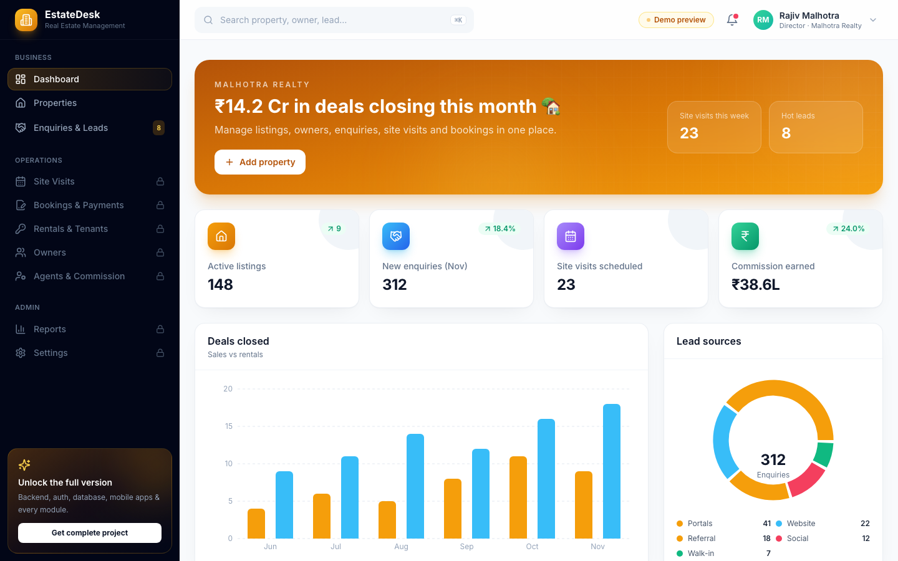
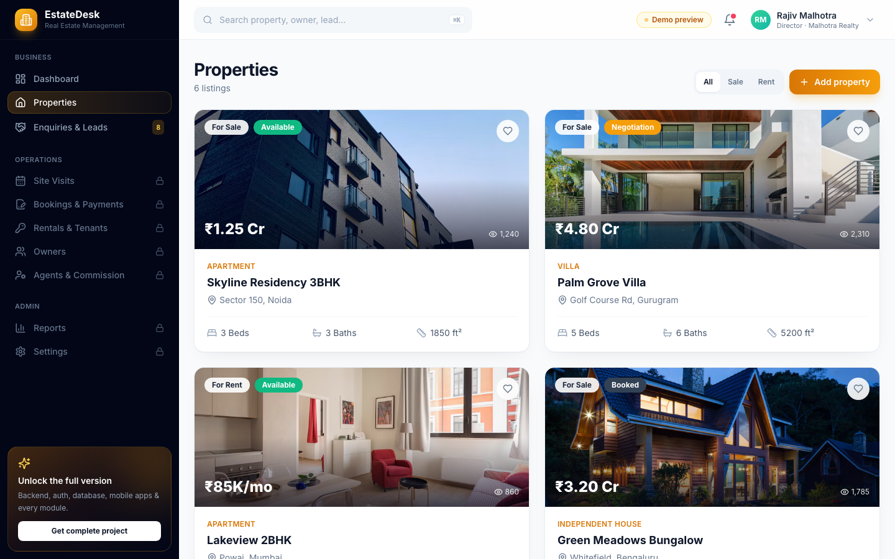
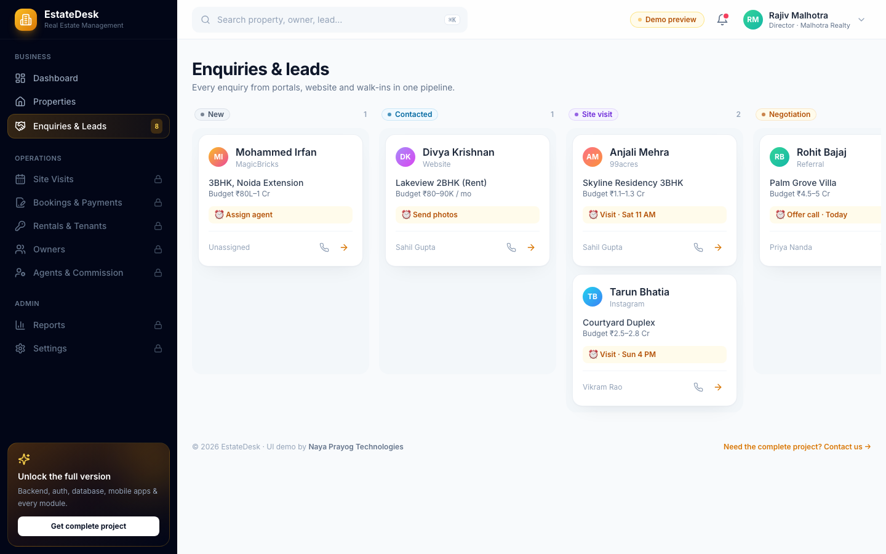

# Real Estate Management Software | Property Management System

**Custom Real Estate Management Software for Property Dealers, Agencies, Brokers and Real Estate Businesses**

Looking for reliable **Real Estate Management Software** to organize your property business, manage listings, track customer enquiries, and streamline real estate operations?

Naya Prayog Technologies develops custom real estate management software and property management solutions for real estate agencies, property dealers, brokers, builders, developers, and entrepreneurs.

Our solutions can help businesses manage property information, customer enquiries, property owners, agents, booking workflows, and administrative activities through a centralized digital platform.

Whether you operate a real estate agency, manage multiple properties, or want to digitize your property business, we can help design and develop software around your operational requirements.

**Looking to digitize your real estate business? Contact Naya Prayog Technologies to discuss your requirements.**

---

## What Is Real Estate Management Software?

Real Estate Management Software is a digital platform designed to help property businesses organize and manage their day-to-day operations.

It can bring different business activities together, reducing dependence on disconnected spreadsheets, paper records, and manual workflows.

A real estate management system may include:

- Property inventory management
- Property listing management
- Buyer and seller management
- Real estate agent management
- Customer enquiry management
- Lead management
- Property booking management
- Rental and lease management
- Transaction records
- Document management
- Administrative dashboards
- Business reports and analytics

The exact functionality depends on the business model and implementation requirements.

## Key Features of Real Estate Management Software

### 1. Property Inventory Management

Organize property information and maintain a structured property database.

Potential capabilities include:

- Add and manage property records
- Update property information
- Upload property images
- Manage property descriptions
- Categorize residential and commercial properties
- Record property locations
- Track listing availability
- Manage property status

### 2. Property Listing Management

Manage property advertisements and listings through a centralized system.

Potential capabilities include:

- Create property listings
- Edit listing information
- Publish property details
- Manage listing categories
- Update property availability
- Manage property photographs
- Organize active and inactive listings

### 3. Customer and Client Management

Maintain organized records of buyers, sellers, tenants, property owners, and business clients.

Potential capabilities include:

- Customer registration
- Customer profiles
- Buyer information
- Seller information
- Tenant records
- Property owner records
- Customer interaction history

### 4. Lead and Enquiry Management

Organize potential customer enquiries and improve the sales follow-up process.

Potential capabilities include:

- Capture property enquiries
- Maintain customer leads
- Track enquiry status
- Record customer requirements
- Assign leads to agents
- Manage follow-up activities
- Maintain enquiry history

### 5. Agent and Employee Management

Support real estate teams through organized employee and agent management workflows.

Potential capabilities include:

- Agent profiles
- Agent information management
- Assign properties to agents
- Assign customer enquiries
- Track agent activities
- Manage employee information
- Role-based access

### 6. Property Booking Management

Organize property booking and reservation activities.

Potential capabilities include:

- Property booking requests
- Customer booking information
- Booking status management
- Reservation records
- Property visit scheduling
- Booking administration

### 7. Rental and Lease Management

For businesses managing rental properties, additional rental workflows can be developed.

Potential capabilities include:

- Rental property records
- Tenant information
- Lease information
- Rental payment records
- Lease duration tracking
- Rental status management
- Renewal reminders

### 8. Document Management

Maintain organized property and customer-related documents.

Potential capabilities include:

- Property documents
- Customer documents
- Agreement records
- Document uploads
- Document categorization
- Document access management

### 9. Financial and Transaction Management

Develop financial workflows according to your real estate business requirements.

Potential capabilities include:

- Transaction records
- Booking payment records
- Property sale information
- Rental payment tracking
- Commission records
- Financial reporting
- Payment gateway integration

### 10. Admin Dashboard and Reporting

Provide administrators with a centralized interface to manage business activities.

Potential capabilities include:

- Centralized administrative dashboard
- Property management
- Customer management
- Agent management
- Lead management
- Booking management
- User access management
- Business reports
- Platform configuration

*Important: The above list describes possible modules for a custom real estate management solution. It does not mean every module is currently implemented in NayaState or available as a ready-to-deploy product.*

---

## Types of Real Estate Management Solutions

### Real Estate Agency Management Software

Manage property inventories, customer enquiries, agents, and business operations.

### Property Dealer Management Software

Organize property information, buyer requirements, seller details, and follow-up activities.

### Property Rental Management Software

Manage rental properties, tenant information, lease records, and payment workflows.

### Builder and Developer Management Software

Organize property inventories, project information, customer enquiries, and booking activities.

### Real Estate CRM Software

Manage potential buyers, sellers, leads, customer interactions, and sales follow-ups.

### Real Estate ERP Software

Develop an integrated platform for property businesses that require multiple administrative and operational modules.

### Property Management System

Manage property-related information and workflows through a centralized digital environment.

---

## NayaState – Real Estate Platform Concept

**NayaState** is a real estate platform concept within the Naya Prayog Technologies product portfolio.

It represents our work toward building digital property discovery and real estate business solutions.

The platform concept is intended to support property-related workflows and digital interactions between relevant users.

For information about its current development status, available modules, product demonstrations, or customization opportunities, contact Naya Prayog Technologies.

**Explore NayaState:** https://nayaprayog.com/nayastate/

---

## Who Can Benefit from Real Estate Management Software?

Our custom real estate software development services can support:

- Real estate agencies
- Property dealers
- Real estate brokers
- Property consultants
- Property management companies
- Builders and developers
- Commercial property businesses
- Rental property businesses
- Real estate startups
- Property investment businesses
- Entrepreneurs launching property platforms

## Benefits of Real Estate Business Automation

**Centralized Property Information**

Organize property records, listing details, and related business information.

**Improved Lead Management**

Maintain customer enquiries and organize follow-up workflows.

**Better Team Coordination**

Manage agent assignments, customer interactions, and business responsibilities.

**Organized Booking Records**

Maintain structured booking and reservation information.

**Reduced Manual Administration**

Digitize suitable business workflows and reduce repetitive manual recordkeeping.

**Business Visibility**

Use centralized dashboards and reporting capabilities to understand relevant operational activities.

**Flexible Business Workflows**

Build a software solution around your agency's actual processes and requirements.

---

## Technology and Development Capabilities

Naya Prayog Technologies works with modern software development technologies to build real estate management platforms.

| Technology | Development Area |
|---|---|
| React / Next.js | Web applications and dashboards |
| Flutter | Cross-platform mobile applications |
| Python / FastAPI | Backend and API development |
| Node.js | Backend services |
| PostgreSQL | Relational database solutions |
| MongoDB | Document-oriented database solutions |
| Firebase | Authentication and related services |

The final technology architecture depends on the project requirements, integrations, security, expected user volume, and scalability needs.

## Real Estate Software Development Process

1. **Business Analysis:** Understand your property business, operations, and challenges.
2. **Requirement Planning:** Identify modules, user roles, and workflows.
3. **UI/UX Design:** Plan the interface and user experience.
4. **Software Development:** Develop the web platform, backend, APIs, and mobile applications if required.
5. **Testing:** Validate functionality and business workflows.
6. **Deployment:** Prepare the agreed software solution for production.
7. **Maintenance:** Plan future enhancements and technical support.

---

## Why Choose Naya Prayog Technologies?

Naya Prayog Technologies is a software development company delivering custom digital solutions for businesses.

Our development capabilities include:

- Real Estate Management Software Development
- Property Management System Development
- Real Estate CRM Development
- Property Listing Platform Development
- Custom ERP Software Development
- Web Application Development
- Mobile App Development
- API and Backend Development
- Admin Dashboard Development
- Business Process Automation

We focus on developing software that supports real business requirements and operational workflows.

Website: https://nayaprayog.com/

---

## Frequently Asked Questions

### What is the purpose of real estate management software?

It helps property businesses organize property records, customer information, enquiries, agents, bookings, and other operational activities through a centralized digital platform.

### Can real estate management software manage multiple properties?

Yes. Property inventory and multi-property management workflows can be included according to business requirements.

### Can I manage customers and property enquiries?

Yes. Customer and enquiry management capabilities can be developed to organize buyer, seller, and tenant information.

### Can this software include real estate CRM features?

Yes. Lead management, customer profiles, enquiry tracking, agent assignments, and follow-up workflows can be included in a custom real estate CRM solution.

### Can rental and lease management be included?

Yes. Rental property records, tenant information, lease details, and rental payment workflows can be discussed as additional modules.

### Can you develop software for my real estate agency?

Yes. We can discuss a customized solution based on your agency's size, business processes, user roles, and operational requirements.

### Can I use my own branding?

Yes. Custom branding and interface requirements can be included in the agreed project scope.

### How much does real estate management software cost?

Pricing depends on the number of modules, user roles, integrations, design requirements, and development complexity. Contact us for a customized proposal.

---

## Start Your Real Estate Software Development Project

**Ready to digitize and streamline your property business?**

Let's discuss how custom real estate management software can support your business operations.

### Contact Naya Prayog Technologies

- **Website:** https://nayaprayog.com/
- **NayaState:** https://nayaprayog.com/nayastate/
- **Email:** support@nayaprayog.com
- **Phone / WhatsApp:** +91 7991327022
- **WhatsApp Enquiry:** https://wa.me/917991327022
- **Portfolio:** https://github.helloharendra.io

**Contact us for a consultation, software demonstration, development estimate, or customized real estate management proposal.**

---

## Related Software Solutions

Explore related solutions and development services:

- Property Listing Platform Development
- Real Estate Website Development
- Real Estate CRM Software
- Property Management System
- Real Estate ERP Software
- Custom CRM Development
- Custom ERP Development
- Business Management Software
- Web Application Development
- Mobile App Development

Visit https://nayaprayog.com/ to explore our products and services.

---

## Developed By

**Naya Prayog Technologies**

Custom Software Development | Real Estate Technology | Web Applications | Mobile Applications | Business Automation

Website: https://nayaprayog.com/

© Naya Prayog Technologies. All rights reserved.

This repository is a product and service showcase. It does not distribute proprietary application source code or grant an open-source license.

<!-- screenshots -->
## Screenshots

**Dashboard**

<table>
  <tr>
    <td align="center" width="50%"><b>Properties</b>  </td>
    <td align="center" width="50%"><b>Leads</b>  </td>
  </tr>
</table>
